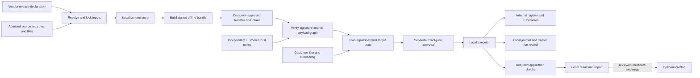

# Architecture

Cinderlock separates preparation, customer authorization, local execution, and
organizational metadata. The boundary matters: a vendor can sign what it ships,
but that signature cannot authorize a mutation of the customer's cluster.

> **Note:** This is a preview feature currently under active development.

The implementation is a Go CLI with a namespaced Kubernetes/Helm adapter and an
optional catalog service. The [feature audit](features.md) is the reference for
requirement coverage and unsupported scope.

## Delivery and execution

Preparation can contact declared upstream sources. Target operations consume
the verified bundle and the customer's internal infrastructure; they do not
reacquire missing upstream artifacts.

The declaration and signed bundle are portable release inputs. A Site, target
snapshot, Plan, Authorization, run journal, and raw report are local operational
material and can contain sensitive topology or observations. Support exports
use a separate allowlisted projection.

## Contracts and authority

The [shared contract package](../internal/spec/) owns strict YAML/JSON input,
canonical JSON, document versions, and schema validation. Unknown fields,
duplicate keys, unsafe numeric representations, and unsupported semantics are
rejected. The alpha API namespace is `cinderlock.dev/v1alpha1`; it is a
Cinderlock format, with no existing Zarf-format compatibility claim.

A Release names assets, directional transitions, operations, required checks,
and recovery procedures. A ReleaseLock records the resolved artifact graph.
The signed BundleIndex commits to that lock and its payload descriptors. This
establishes closure of declared artifacts, not discovery of every possible
runtime dependency.

The customer-controlled Site selects the target and operational capabilities.
Its independent TrustPolicy admits release and approval keys under application
and channel scopes. Release signing, execution authorization, and catalog packet
signing use separate signed domains. A key carried inside release content does
not admit itself. The local release sequence floor and policy minimum sequence
provide replay controls within their retained state.

The customer explicitly enrolls an independently reviewed policy digest for
the actual target using `trust admit-policy`. A per-target policy floor binds
its epoch and digest; plan producers and execution reject missing, changed, or
older admission. A [trust-update packet](../internal/trustupdate/) uses a separate
signature domain, the current global policy-administrator key, exact previous
policy identity, next epoch, target, decision reference, and bounded validity.
Key rotation requires an overlap epoch. Preview exposes the precise changes;
admission requires the reviewed packet digest and writes a new policy file.
The filesystem publication and SQLite floor are separate commit domains, so an
uncertain failure can leave a prepared file that requires reconciliation.
It cannot silently overwrite the active Site policy. Retained local state is
part of replay protection; deleting it does not preserve that history.

A Plan binds the signed recipe, bundle, Site source bytes, normalized Site,
policy digest/epoch, target identity, and observed starting state. Execution
revalidates those bindings before writes and at safe step boundaries. Ordinary
workload readiness changes are excluded from configuration fingerprints;
configuration, ownership, UID, effective-values, and secret-binding changes
remain relevant. Secret values are not copied into the snapshot.

The [permission preflight](permissions.md) derives Kubernetes request tuples
from the supported observer/coordination path, chosen operations, and Helm
object inventories. SelfSubjectAccessReview results concern the selected
kubeconfig identity at query time. They do not establish server admission,
future grants, or application service-account access.

## Artifact ownership and transfer

The [bundle package](../internal/bundle/) owns source acquisition, the content
store, signed archives, inventory, and materialization. Source credentials are
ephemeral exact-host inputs. Registry CDN/download redirects require explicit
host admission and cannot carry origin credentials across hosts. Target
registry credentials are configured separately by the customer.

Every outgoing registry request also passes the transport's host/scheme gate.
Bearer-token realms can create new requests without an HTTP redirect, so they
require separate explicit HTTPS authentication-host admission. A CDN-only host
cannot receive credentials or request bodies.

The [source export package](../internal/sourceexport/) prepares a separate
source-build distribution from an explicit public-file allowlist. It vendors
dependencies in the copied workspace, retains vendor license files, rejects
local module replacements and symlinks, and records every exported file. A
matching Go distribution and a Helm binary with an operator-admitted notice
tree can be included explicitly. The [separate Helm tool module](../tools/helm/)
pins upstream source and dependency identities, builds offline after vendoring,
and scans the resulting binary before exclusive publication. The
manifest is an integrity inventory for independent admission, not a signature
or scanner clearance. It carries no local module-cache paths or credentials.

Source copying and inventory use anchored directory handles, including a new
handle for each descended directory, so a replaced ancestor cannot redirect
reads outside the admitted tree. The separate offline build captures a private
complete copy and verifies it against the initial manifest before compiling.
It uses that snapshot's source and bundled Go, an empty module cache, vendoring,
and disabled Go network lookup, then reverifies the snapshot before exclusive
executable publication. Explicit input-relative Go paths stay snapshot-relative;
external Go distributions remain separately admitted host infrastructure.
The private working directory assumes a trusted operating system and excludes
privileged or same-user tampering from this filesystem boundary. The build
never runs its output. Native build/toolchain evidence does not qualify
another operating system, GPU, or application deployment profile.

Payloads are streamed and independently hashed. OCI images retain their exact
manifest/config/layer graph; imports verify the destination digest and contents.
Archive verification rejects malformed, duplicate, unindexed, linked, or
traversing members before exposing a verified working directory. The signed
inventory records artifact/file composition and explicitly incomplete scanner
coverage. Detailed format rules and upstream licenses have one home in
[bundle and transfer implementation](REUSE-bundle.md).

The [transfer package](../internal/transfer/) handles multipart transport and
exact-base differentials. Transport checks do not grant release trust. A
differential reconstructs the complete signed target and verifies it under the
recipient's policy before publishing a full archive. Cache cleanup serializes
with producers, computes references conservatively, and rejects stale cleanup
plans. It does not clean application PVCs or internal registry storage.

## Target adapter and uncertainty

The [engine package](../internal/engine/) owns observation, planning, pinned
Helm execution, Kubernetes Jobs, hardware evidence, coordination, and recovery.
The kubeconfig and context must be explicit. The current profile rejects
credential-execution plugins, insecure Kubernetes TLS, and implicit proxy
routes. Helm runs with a verified binary digest and a controlled local
environment, without ambient plugins.

Chart rendering uses the observed install/upgrade context and is restricted to
supported namespaced resource kinds and declared digest-pinned images. A plan
binds the rendered desired-state digest. Execution uses frozen validated
objects, so Helm cannot execute a different branch of the original templates
after validation. Common lookup, nondeterministic template, and hook patterns
are rejected. Inspection remains a bounded supported-chart profile, not a
complete analyzer of all Helm template behavior. Values apply
in the order of bundled values, customer Site overrides, then generated image
bindings. Required HTTP and command checks execute as namespaced Jobs, so they
observe the workload network rather than only the operator workstation.

The [state package](../internal/state/) stores private SQLite run records,
operation intent/outcomes, worker identities, checkpoints, authorization use,
release floors, and ordered events committed with state transitions.
SQLite uses WAL and full synchronization. Before an external operation, the
executor records intent locally and in a cluster ConfigMap. A cluster Lease
coordinates the application, while the local active-run constraint prevents a
second unresolved run in the same journal. Lease expiry alone never grants
takeover authority. There is no distributed transaction between SQLite,
Kubernetes, Helm, and application data.

An operation can commit while the caller loses its response. The executor
preserves that uncertainty, observes its stable Job identity, and requires a
declared reconciliation procedure when needed. It does not blindly repeat a
non-idempotent action. Cancellation stops new steps at a safe boundary; it does
not prove that an existing Job, Helm operation, or database write stopped.
Unsupported uncertain outcomes require a reviewed recovery procedure or local
operator intervention.

Every operation and acceptance Job binds the server UID and normalized recipe
in the durable journal. A replacement under the same name cannot establish the
original worker's completion. Lost create responses remain uncertain, and
recovery must establish that relevant workers are terminal. Legacy journals
retain their history but cannot acquire missing worker identity through a
schema migration or automatically resume the new execution protocol.

Recovery has its own plan and authorization against actual state. It preserves
the failed attempt and requires declared application acceptance. A prior-chart
Helm downgrade is rejected by the current adapter rather than deploying the
target chart under a previous-version label. Retirement is a separate retained
data operation, not a purge or proof that external data is recoverable.

## AI and application acceptance

AI assets are normal content-addressed inputs with additional declared
relationships: model, tokenizer, adapter, runtime, precision, and embedding/index
revisions. Mechanical identity and transition checks do not establish a useful
or compatible model. The application author supplies representative checks and
thresholds.

The NVIDIA path uses a separately authorized fixed probe Job, records observed
device/model/memory/driver identities, and rechecks the original node, Job, Pod,
and output. GPU workload bindings must match the probed node. This full-GPU
profile excludes MIG and known sharing configurations; it does not install or
repair drivers. Total device memory is not free memory or a proven model fit.

Model staging uses separate revision/run-owned PVCs. A vendor seeding command
is followed by fixed helper verification of the signed file manifest on a
read-only mount. Helper/carrier images must themselves be admitted and locked.
The fixture's tiny local assets are a transport test, not GPU qualification.

Acceptance remains separate across integrity, readiness, workflow, and recovery.
Missing or blocked required checks prevent accepted completion. The framework
does not synthesize browser/login, scheduled-task, AI-quality, or production
backup tests. A passed check applies to its recorded scope and conditions.

## Local evidence and optional organization service

The [report and support packages](REUSE-service.md) produce standalone HTML,
JSON, Markdown, and allowlisted export previews. They require no remote fonts,
scripts, telemetry, or automatic upload. Raw local results can be sensitive;
reviewed support snapshots deliberately exclude raw logs, errors, documents,
configuration, and evidence attachments. This is not automatic secret detection.

The optional [catalog package](../internal/catalog/) stores immutable scoped
observations in SQLite or PostgreSQL. It provides a read-only server-rendered
view, authenticated APIs, project/site roles, exact review metadata, and signed
packet exchange with replay controls. Remote listeners require explicit TLS.
Internal OIDC verifies admitted bearer ID tokens; it does not implement a
browser OAuth login flow.

The catalog has no cluster deployment engine or implicit access into a strict
gap. A catalog approval record is metadata, not an engine Authorization.
Imported timestamps describe observations, not live site health. GitOps export
similarly produces reviewed controller input and observes exact revisions; it
does not take ownership from Argo CD or Flux or push a repository change.

Recorded comparisons bind each result to its original plan, Site, profile, and
test scope. Coverage changes and stale observations stay visible. Configured
notifications enter a local outbox with reviewed export; nothing is sent by
that operation. Typed external evidence separately binds an admitted producer
and version to the exact run/bundle/target/profile/test scope and expires under
its own key policy. Attaching it preserves the producer's limited claim and
cannot promote the engine's original acceptance result.

The local [dependency scanner and proposal API](discovery.md) read bounded
source/configuration inputs without executing the application. Static findings
are potential dependencies. Optional zero-context patches only enable explicit
disabled allowlisted Hugging Face switches in supported dotenv/Compose syntax;
they require review, cached artifacts, and workflow testing. The API never
applies them or establishes runtime dependence.

## Qualification and operational limits

The checked-in tests exercise strict input, hostile bundles, source credential
scope, graph transfer, stale plans, uncertain operations, state persistence,
role boundaries, packet replay, exports, and synthetic application behavior.
Fake Kubernetes clients isolate state/fault cases; optional registry and
PostgreSQL tests require explicit environment settings. These are distinct
from a live cluster transition, real GPU workload, physical network isolation,
or customer production restore.

The largest remaining product gaps include multi-domain peak storage
accounting, admission/workload-identity qualification, compatibility
qualification, browser/scheduled runners, and producer-specific external report
adapters. See the per-feature audit before treating a profile as supported.
Offline source builds still require independent admission of the exported
source, dependencies, and toolchain; successful compilation does not qualify
the deployment or establish physical isolation.
